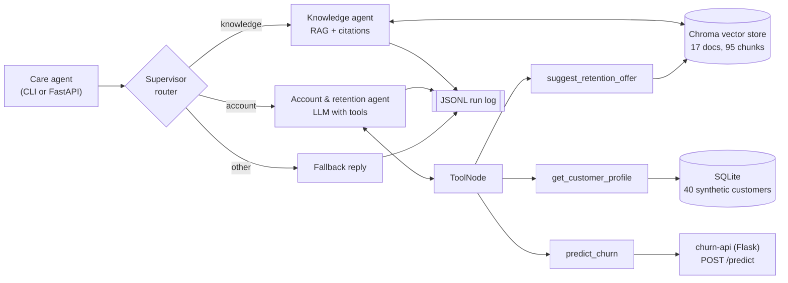

# Telecom Support Agent

A multi-agent support copilot for **NileTel**, a fictional telecom operator. It is built with LangGraph and combines retrieval-augmented generation (RAG) over a policy knowledge base with tool calling against a customer database and a separate churn-prediction REST API. It ships with an evaluation suite, run logging, a FastAPI service and Docker setup.

> NileTel, its plans, prices, codes and customers are all invented for this project. No real operator's data is used.

## The problem

Customer-care agents at a telecom operator have two kinds of questions:

1. **Policy questions:** "How much is a roaming day pass in Saudi Arabia?", "What's the APN?", "What's the early termination fee?" The answers live in dozens of internal documents.
2. **Customer-specific questions:** "Customer NT-1003 wants to cancel. What can I offer?" To answer, the agent has to look up the customer, judge how likely they are to leave, and pick an offer the retention policy allows.

This project handles both. A supervisor routes each request to a specialist agent. The knowledge agent answers from retrieved documents and cites them. The account agent works through several tool calls: it reads the customer profile, gets a churn prediction from a separate ML service, and then applies the retention policy.

## Architecture



The LangGraph graph (`src/telecom_agent/graph.py`):

```
START -> supervisor --knowledge--> knowledge_agent -> END
                    --account----> account_agent <-> tools   (ReAct loop until no more tool calls)
                    --other------> other -> END
```

## How it works

**1. Ingestion pipeline** (`ingest.py`). Markdown files are split by heading into sections. Each section is packed line by line into chunks of about 120 words with about 30 words of overlap. Splitting on line boundaries keeps table rows and bullet points whole. The document title and section heading are added to the front of each chunk before embedding (a "contextual chunk header"), so a short chunk such as a price table still carries its topic. The vectors are stored in a persistent Chroma collection with `source`, `title`, `section` and `chunk_index` metadata. Each embedding backend gets its own collection, so vectors of different dimensions never mix.

**2. Embeddings** (`embeddings.py`). You choose the backend with `EMBEDDING_BACKEND`:
- `sentence-transformers`: `all-MiniLM-L6-v2` on CPU (the default).
- `ollama`: `nomic-embed-text`, with the `search_document:`/`search_query:` prefixes that model expects.
- `hashing`: scikit-learn `HashingVectorizer`, a lexical fallback that needs no download. The tests use it.

**3. Supervisor routing** (`router.py`). Three interchangeable routers share one interface:
- `rules`: weighted regex signals (a customer ID such as `NT-1234`, "churn", "wants to cancel", "switching to another operator"…), damped by policy wording ("according to policy…"). It is instant and deterministic, and it is the default.
- `semantic`: votes among the 3 nearest example utterances in embedding space.
- `llm`: the chat model returns a Pydantic `RouteDecision` through structured output. If the LLM fails or returns malformed output, the `rules` router takes over.

**4. Knowledge agent.** Retrieves the top-k chunks (k=4) and puts them into a grounded prompt. The prompt tells the model to cite `[file.md]` after each fact and to say so when the context doesn't contain the answer. The retrieved sources are also returned as structured data.

**5. Account & retention agent.** A tool-calling ReAct loop built with LangGraph's `ToolNode` and `tools_condition`. The system prompt sets out the steps: profile → churn → offer → answer. The tools (`tools.py`) are:
- `get_customer_profile(customer_id)` reads SQLite. The columns mirror the IBM Telco churn dataset schema.
- `predict_churn(customer_id)` converts the profile into the churn API's 18-field JSON payload and POSTs it to `CHURN_API_URL/predict`, with a timeout. If the call times out, can't connect, returns a non-200 status or returns malformed JSON, the tool returns an `{"error": ..., "risk": "unknown"}` result instead of raising, so the agent can explain the problem and carry on.
- `suggest_retention_offer(customer_id, churn_risk)` applies the policy rules (one price discount at most, one non-price offer at most, a thank-you reward for low risk). It then uses metadata-filtered retrieval (`source="retention_offers.md"`) to pull the matching policy text, so the answer can cite it. If the churn service was down, it estimates the risk from the contract and tenure and flags that estimate.

**6. Conversation memory.** An `InMemorySaver` checkpointer keys the state by `session_id`. A customer ID given earlier in the conversation is remembered for later turns.

**7. Monitoring** (`monitoring.py`). Each request appends one JSON line to `logs/runs.jsonl` with: timestamp, model, router mode, embedding backend, route and the reason for it, tools called, number of tool errors, retrieved sources, latency and any error. `python -m telecom_agent logs` summarises the log: runs per route, average and p95 latency, failed runs, calls per tool, tool error rate and top sources.

**8. Serving.** FastAPI exposes `POST /chat` and `GET /health`; the health check covers the vector store size, the router mode and whether the churn API is reachable. There is also a CLI (`python -m telecom_agent chat`), a Dockerfile and a docker-compose file that can start the churn-api next to the agent.

## Project structure

```
telecom-support-agent/
├── data/knowledge_base/       17 NileTel markdown documents (plans, roaming, billing, policies…)
├── src/telecom_agent/
│   ├── config.py              settings from environment variables
│   ├── embeddings.py          sentence-transformers / ollama / hashing backends
│   ├── ingest.py              load -> section split -> chunk with overlap -> embed -> Chroma
│   ├── retriever.py           KnowledgeBase.search() with optional metadata filter
│   ├── database.py            synthetic SQLite customers (Telco churn schema)
│   ├── churn_client.py        HTTP client for churn-api (timeouts, error handling)
│   ├── tools.py               the three agent tools + retention rules
│   ├── prompts.py             every prompt template in one place
│   ├── router.py              rules / semantic / LLM supervisor routers
│   ├── graph.py               the LangGraph multi-agent graph
│   ├── agent.py               SupportAgent: wiring + per-run logging
│   ├── llm.py                 chat model factory (ollama / anthropic / openai)
│   ├── monitoring.py          JSONL logger and log summary
│   ├── evaluation.py          hit@k, MRR, routing metrics, LLM-as-judge
│   ├── api.py                 FastAPI app
│   └── __main__.py            CLI
├── eval/
│   ├── questions.jsonl        42 labelled questions (route + expected source documents)
│   ├── run_eval.py            retrieval + routing evaluation -> results.json
│   ├── judge_faithfulness.py  optional LLM-as-judge (needs a configured LLM)
│   └── results.json           output of the last evaluation run
├── tests/                     pytest suite with a scripted fake LLM and mocked HTTP
├── Dockerfile, docker-compose.yml, requirements.txt, .env.example
```

## Setup

Requires Python 3.10+ (developed on 3.13).

```bash
python -m venv .venv && source .venv/bin/activate
# Linux without a GPU: install CPU torch first to avoid a large CUDA download
pip install torch==2.14.1 --index-url https://download.pytorch.org/whl/cpu
pip install -r requirements.txt
pip install -e .
cp .env.example .env

python -m telecom_agent seed-db   # creates data/customers.db (40 synthetic customers)
python -m telecom_agent ingest    # builds the Chroma index (downloads MiniLM on first run)
```

### Option A: local LLM with Ollama (default)

```bash
ollama pull qwen2.5:7b            # any tool-calling model works; set OLLAMA_MODEL
# optional: local embeddings too
ollama pull nomic-embed-text      # then EMBEDDING_BACKEND=ollama and re-run ingest
```

`.env`:
```
LLM_PROVIDER=ollama
OLLAMA_MODEL=qwen2.5:7b
```

### Option B: Claude through the Anthropic API

`.env`:
```
LLM_PROVIDER=anthropic
ANTHROPIC_API_KEY=sk-ant-...
ANTHROPIC_MODEL=claude-haiku-5-5
```

OpenAI works the same way (`LLM_PROVIDER=openai`, `OPENAI_API_KEY`, `OPENAI_MODEL`).

### Connecting the churn-api

The `predict_churn` tool calls the separate **churn-api** Flask service (a logistic-regression model trained on the IBM Telco churn dataset). Start it as its own README describes, then check it:

```bash
curl http://localhost:5000/health  # {"status":"ok","model":"LogisticRegression","threshold":0.4}
```

Set `CHURN_API_URL` if it runs somewhere else. If the service is down, the agent keeps working: the tool reports the error, and the retention tool falls back to a risk estimated from the profile.

### Run it

```bash
# terminal chat (pass --customer to set the active customer)
python -m telecom_agent chat --customer NT-1003

# one question
python -m telecom_agent ask "How much is a roaming day pass in Saudi Arabia?"

# API
python -m telecom_agent serve --port 8000
curl -X POST localhost:8000/chat -H 'content-type: application/json' \
     -d '{"message": "Customer NT-1001 wants to cancel. What can I offer?"}'
curl localhost:8000/health

# monitoring summary
python -m telecom_agent logs
```

`/chat` returns `answer`, `route`, `sources`, `tools_called`, `session_id`, `run_id` and `latency_ms`. To continue a conversation, send the `session_id` back.

### Docker

```bash
docker compose up --build                   # agent only, Ollama on the host
docker compose --profile churn up --build   # agent + churn-api built from ../churn-api
```

The image builds the customer DB and the vector index at build time. The compose file expects `../churn-api` to contain a Dockerfile that serves on port 5000.

## Evaluation

`eval/questions.jsonl` holds 42 hand-labelled questions: 30 knowledge, 8 account, 4 other. Each one is labelled with its expected route, and each knowledge question with the document(s) that answer it.

```bash
python eval/run_eval.py                       # retrieval for both backends + rules/semantic routers
python eval/run_eval.py --routers rules,semantic,llm   # also evaluates the LLM router (needs an LLM)
python eval/judge_faithfulness.py --limit 10  # LLM-as-judge on answers (needs an LLM)
```

### Metrics

- **hit@k:** share of questions where at least one of the top-k retrieved *chunks* comes from an expected document.
- **MRR:** mean of 1 / rank of the first relevant chunk, counting only the top 10 (0 if none is there).
- **Router accuracy:** share of questions routed to the labelled route.

### Results (from `eval/results.json`)

Knowledge base: 17 documents, 95 chunks (120-word chunks, 30-word overlap).

**Retrieval** (30 questions that have expected sources):

| Embedding backend | hit@1 | hit@3 | MRR | avg query time |
|---|---|---|---|---|
| sentence-transformers `all-MiniLM-L6-v2` | **0.933** | **0.967** | **0.950** | 13.2 ms |
| hashing (lexical, offline) | 0.833 | 0.967 | 0.901 | 7.9 ms |

**Routing** (all 42 questions):

| Router mode | Accuracy | knowledge recall | account recall | other recall |
|---|---|---|---|---|
| rules (keyword/regex) | 1.000 | 1.00 | 1.00 | 1.00 |
| semantic (MiniLM, 31 example utterances) | 0.929 | 0.90 | 1.00 | 1.00 |
| llm | not run (no LLM was reachable when these numbers were produced) | | | |

How to read these numbers:

- **The rules router's 100% is optimistic.** I wrote the rules and the questions myself, so the test set is in-distribution for the rules. It shows the rules cover the phrasing I expected, not how well they generalise. The semantic router's 92.9% is a fairer estimate for unseen phrasing: its examples were written separately and not tuned on this set. Its 3 errors are all knowledge questions sent to `account`, and they contain first-person or customer wording: "What happens to my number if I don't recharge…", "Can I cancel a new contract…", "…a month-to-month customer at high risk of leaving?".
- **The one hard retrieval miss is a vocabulary gap.** For "Does unused data carry over to the next month on prepaid?", MiniLM ranks the "Data rollover" section only 13th. The query says "carry over" and the document says "rolls over"; "next month" pulls in the billing-cycle sections instead. The lexical backend ranks it 1st, which is a good argument for hybrid search (see next steps).
- The set is small (42 questions), so a single question moves hit@1 by 3.3 points.
- Answer quality (faithfulness) has **not** been measured yet. `judge_faithfulness.py` is implemented and unit-tested with a fake model, but it needs a real LLM to run.

## Tests

```bash
pytest -q        # 45 tests, runs offline in a few seconds
```

The tests run without any network access or LLM:
- `ScriptedChatModel` (`tests/fake_llm.py`) is a LangChain chat model that returns pre-written messages, including tool calls, and records every prompt. This keeps the graph deterministic and lets the tests check what the LLM was shown.
- `responses` mocks the churn API, including timeouts, refused connections, HTTP 500 and malformed JSON.
- What's covered: ingestion and chunk overlap, retrieval and metadata filtering, the churn payload schema, retention rules, all three routers (including the LLM router's fallback), the full multi-step tool loop, a churn-service outage, session memory, run logging, the FastAPI endpoints and the eval metrics.

## Design decisions

- **Explicit graph instead of a prebuilt agent.** The supervisor, the specialists and the tool loop are wired by hand with `StateGraph`, so the control flow is visible and each node can be tested on its own. Only `ToolNode` and `tools_condition` come from the prebuilt helpers.
- **Deterministic routing by default.** Routing is a 3-way classification. Regex rules handle the clear cases at no cost and in under a millisecond. The LLM router is there for ambiguous phrasing and falls back to the rules when it fails. The same pattern works as a cost-saving fast path in production.
- **Business rules in code, policy text from RAG.** Which retention offer a customer is eligible for is decided by plain Python that can be audited and unit-tested. The policy wording is retrieved and cited. The LLM explains the decision but doesn't make it, which matters when money (discounts) is involved.
- **Tools return errors as data.** A failing churn API shouldn't crash the conversation. The model gets `{"error": ...}`, tells the care agent, and the run log counts it as a tool error.
- **Dependency injection everywhere.** `SupportAgent` accepts the LLM, embeddings, churn client and router as arguments. The CLI, the API and the tests all build the same object with different parts.
- **One collection per embedding backend.** Switching backends doesn't need a migration, and vectors of different dimensions never mix.
- **The copilot is for care agents, not customers.** That's why the churn score can be shown to the person using the tool. The account prompt reminds the care agent not to quote it to the customer.

## Limitations

- No real LLM was available in the environment where this was built. The LLM paths (knowledge answers, the tool-calling loop with a real model, the LLM router and the judge) are tested with a scripted model, not with Qwen or Claude. How well a 7B local model follows the multi-step tool protocol still needs to be measured.
- The rules router is tuned to the author's phrasing (see the evaluation notes), and the eval set is small and hand-written.
- English only. Egyptian customers often write in Arabic or Franco-Arabic, and MiniLM is an English model.
- The customer data is synthetic. `monthly_charges` is kept on the IBM Telco dataset's scale so the churn model gets inputs in its training range; the NileTel bill in EGP is stored separately.
- Conversation memory is in-process (`InMemorySaver`), so sessions are lost on restart and aren't shared between workers.
- There is no authentication on the API, and no PII redaction in the logs (questions are logged, truncated to 200 characters).
- The Docker image and docker-compose setup were written and the compose file validated, but the image has not been built here (no Docker daemon was available).

## Next steps

- **Hybrid retrieval:** fuse MiniLM and BM25/lexical rankings with reciprocal rank fusion. The q02 miss above is exactly the case this fixes.
- **Multilingual support:** a multilingual embedding model (e.g. `multilingual-e5-small`) and Arabic questions in the eval set.
- **Measure answer quality:** run the faithfulness judge and an end-to-end tool-use eval (did the agent call the right tools in the right order?) with Qwen and Claude, and compare them.
- **Persistent sessions:** swap `InMemorySaver` for the SQLite or Postgres LangGraph checkpointer.
- **Tracing:** add LangSmith or OpenTelemetry tracing next to the JSONL log, and a reranker if retrieval depth grows.
- **Human handoff:** a node that escalates to Tier 2 when retrieval confidence is low or the customer is high-risk and refuses the offers.

---

Author: Basel Abdelbary
